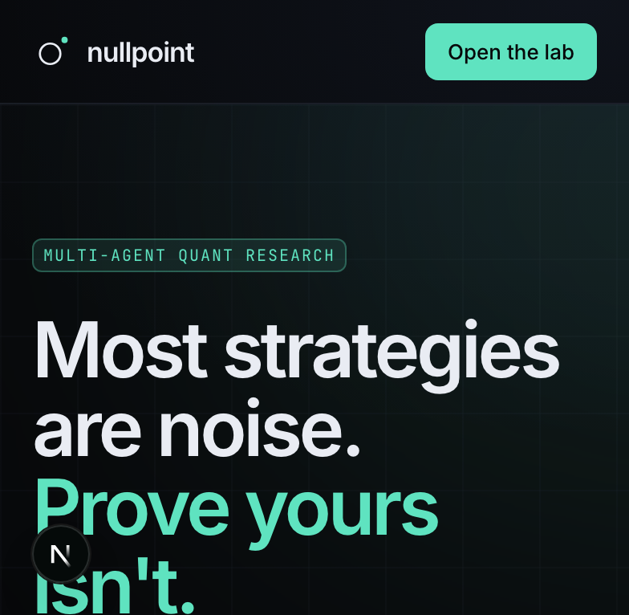

# Nullpoint

**Nothing ships until it beats the null.**

Nullpoint is a multi-agent autonomous quant research platform. Ten specialised agents propose,
implement, backtest and then try to falsify systematic strategies on free data. A strategy reaches the
leaderboard only after it survives an explicit anti-overfitting gauntlet, and nothing can place a live
order — that code path does not exist.

Research software only. Not investment advice, not a signal service, not a broker.



## What it does

- **10 agents, one typed bus.** Orchestrator, ideator, quant, engineer, backtester, skeptic, risk
  officer, librarian, portfolio manager, auditor. Every message, tool call and token is persisted and
  replayable.
- **Agents that actually talk to each other.** A research room puts 2–5 specialists in one thread
  with a shared evidence bundle: each answers a named point made by the previous speaker, the
  orchestrator closes with a cited synthesis, and the whole round streams token by token over SSE.
  Sprint transcripts show the same hand-offs (skeptic rejection → coder's stated fix → risk review).
- **Generative UI.** Agents can emit a `ui` spec — metrics cards, tables, charts, gate receipts,
  checklists, callouts — which the client renders with native components instead of raw text. Only
  values that came from the database or a tool may appear in one; malformed specs are dropped.
- **Falsification, not curve fitting.** Walk-forward (anchored/rolling), purged + embargoed K-fold,
  CPCV, PBO/CSCV, deflated Sharpe against a global trial counter, Monte Carlo trade/block bootstrap,
  random-entry and signal-shuffle nulls, cost 2×/3× stress, execution delay, regime coverage and a
  sealed holdout.
- **True optimization.** Exhaustive pre-registered grids for PBO/plateau, plus TRIBES (adaptive,
  parameter-free particle swarm) re-fitted on every walk-forward train window with warm-up history.
- **Cost-aware engine.** Native NumPy/pandas reference implementation with next-bar fills, commission,
  spread, slippage, borrow, stops, position caps and vol targeting. `vectorbt` and `backtesting.py`
  adapters are optional extras.
- **Free data, honest labels.** Yahoo, Stooq, FRED, SEC EDGAR, Fama-French, Binance/ccxt, plus optional
  Every provider carries its licence note; every universe carries its survivorship-bias warning.
  Prices are always real market data: when a feed fails the run reports the provider error instead of
  substituting generated prices.
- **Registry and portfolio.** Strategy versioning, lineage, diff, embedding dedupe, experiment ledger
  with data/code hashes, HRP / risk parity / inverse-vol / mean-variance construction, paper trading
  with drift, alerts, cost dashboard.
- **Product surface.** Next.js 15 app (dark-first brand), FastAPI with JWT,
  SSE token streaming, Arq worker, Postgres or sqlite, Parquet/DuckDB lake, Prometheus metrics,
  Docker Compose, CI.

## Quickstart

### Docker (full stack)

```bash
cp .env.example .env
docker compose up --build
# web  → http://localhost:3000
# api  → http://localhost:8000/docs
```

### Local

```bash
uv sync --extra dev
npm --prefix apps/web install
cp .env.example .env

make api      # http://localhost:8000/docs
make worker   # Arq worker (sprint queue + nightly drift)
make web      # http://localhost:3000
```

No key? Set `LLM_PROVIDER=mock` (the default in tests). The mock provider runs the real tools,
backtests and validation gates deterministically. With `OPENROUTER_API_KEY` set, `LLM_PROVIDER=auto`
uses free OpenRouter models by default; set `MODEL_*` to a paid model only if you want one.

### First backtest

Sign in, open `/chat` and ask for a strategy, for example
`Create me a robust nasdaq trading strategy`. The desk picks a universe and candidate families, runs
the real grid and gauntlet on market data, and posts the measured metrics, equity curve, every gate
and a link to the stored strategy. Nothing in the UI is fabricated: before a session loads, pages show
empty states, and with no token they show that you are not signed in.

```bash
make tearsheet      # re-render standalone HTML tearsheets into artifacts/
```

## Repository layout

```
apps/api/          FastAPI app (routers, services, jobs, models, security)
apps/web/          Next.js 15 app (brand, pages, charts, API client)
engine/            backtest engine, features, metrics, portfolio, validation gauntlet
agents/            roster, orchestrator, bus, tools, templates, tearsheets, embeddings
data/              providers, quality checks, Parquet/DuckDB lake, universes, pipeline
sandbox/           AST scanner + Docker/subprocess runners for untrusted agent code
brand/             NAMES.md, BRAND.md, palette, logo/wordmark/favicon/OG SVGs
docs/              ARCHITECTURE, API, SECURITY, DATA_LICENSES, SETUP, DEMO, DECISIONS
infra/             Fly.io / Railway deployment configs and checklist
scripts/           demo sprint, seed, tearsheet re-render
tests/             engine, validation, noise gate, data, agents, API
```

## Validation gates

Configured in `engine/validation.py` (`GATES`) and applied to every candidate:

<!-- gates:start -->
| Gate | Threshold | Critical | Source key |
|---|---|:---:|---|
| Walk-forward OOS Sharpe | >= 0.5 | yes | `oos_sharpe_min` |
| WFO efficiency (OOS / IS) | >= 0.4 |  | `wfo_efficiency_min` |
| CPCV median OOS Sharpe (train-only params) | >= 0.3 | yes | `cpcv_median_sharpe_min` |
| PBO / CSCV | <= 0.35 | yes | `pbo_max` |
| Deflated Sharpe (per-period units, effective trials) | >= 0.9 | yes | `dsr_min` |
| Block-bootstrap P(SR <= 0) | <= 0.1 | yes | `mc_prob_le_zero_max` |
| Random-entry null p-value | <= 0.1 |  | `random_entry_p_max` |
| Placebo shuffle p-value (same costs/turnover) | <= 0.1 | yes | `signal_shuffle_p_max` |
| Sharpe at 3x costs, +1 bar | >= 0.3 | yes | `cost_3x_sharpe_min` |
| Sharpe with +1 extra bar delay | >= 0.3 |  | `delay_sharpe_min` |
| Parameter plateau share | >= 0.4 |  | `plateau_share_min` |
| Minimum track record | >= 1 years and >= 20 trades | yes | `min_trades` |
| Median regime Sharpe (60+ days, <= 1 regime below the floor) | >= -0.25 | yes | `regime_min_sharpe` |
| Sealed holdout | one-time, human-only, logged before opening | yes | policy |

Generated from `engine/validation.py` by `scripts/render_gates.py`. Do not edit this table by hand.
<!-- gates:end -->

One failed critical gate blocks promotion. Rejections are stored with a tearsheet; deleting them would
make the trial count lie.

A gate that **cannot be evaluated** on the sample — too few observations for CPCV/PBO, a
single-parameter grid with no plateau geometry, a stress run that errors, a history shorter than the
regime buckets need — is recorded as `skip`, excluded from the score, and never counted as a failure.
A gate that is computed and fails still blocks. This keeps "we could not test it" from being reported
as "the strategy is broken", which was rejecting otherwise sound candidates on short samples.

Deflated Sharpe deflates by the effective, correlation-clustered number of trials in the **current
search family**; the org-wide monotonic trial counter is still recorded (`n_trials`) and audited
(`dsr_global_audit`) so search history stays visible without eventually rejecting every strategy.

## Status ladder and safety

`idea → backtested → validated → candidate → paper → live_ready`

`live_ready` is a **label for human review**, not an execution state. There is no broker order code
anywhere in the repository. Paper trading requires a stored human approval record; the simulator
bootstraps the strategy's own out-of-sample returns and is labelled simulated. Agent code executes in
a sandbox (no network, read-only mounts, CPU/RAM/PID/wall-clock limits, AST method allowlist). The
Docker backend is used whenever available and production fails closed if it is not; the local
subprocess runner is development-only.

## Evidence gates after validation

A passing validation report is not a performance claim. `GET /strategies/{id}/claim` withholds all
headline metrics until three things exist:

1. the latest validation report passed;
2. a human opened the sealed holdout exactly once and its metrics were recorded
   (`holdout_evaluation` is uniquely constrained by strategy version);
3. a paper run has at least `MIN_PAPER_DAYS` distinct forward days and no active drift alert.

Simulator paper results are labelled as simulated. The gate returns explicit blockers instead of
pretending missing evidence is a pass.

## Operations

- **Migrations.** Alembic owns the schema in staging/production (`alembic upgrade head`);
  `alembic check` fails on model drift. `AUTO_CREATE_SCHEMA` is for dev/test only.
- **Sandboxed backtests.** With `ENGINE_SANDBOX=true`, the native engine runs in the sandbox
  (`engine/sandbox_adapter.py`) instead of compiling agent code in the worker. Production refuses
  to boot with it disabled. Build the image with `make sandbox-image`.
- **Durable jobs.** Every worker attempt is recorded in `job_attempt`. A sprint whose heartbeat is
  stale is requeued up to `JOB_MAX_ATTEMPTS`; deterministic failures are not retried automatically.
- **Typed research artifacts.** Proposals are frozen with a hypothesis, falsifier, critique and trial
  plan before code runs; the funnel prevents duplicate pre-registration and over-budget trials.
- **Staging.** `infra/fly.staging.toml` is a separate app/database/Redis/lake configuration.
- **Performance.** Symbol downloads run concurrently. The native engine reuses its feature
  panel across parameter trials and extracts trades in NumPy instead of per-trade pandas
  slicing; subprocess/sandbox grids can also overlap via an ordered, hardware-aware pool.
  `NULLPOINT_MAX_WORKERS` or `MAX_WORKERS` caps concurrency; `1` forces deterministic
  sequential execution. The pool never receives the DB session, so trial accounting stays
  thread-safe and is committed once per batch.

## Research tools and providers

- **Any LLM API.** `LLM_PROVIDER` accepts `mock`, `anthropic`, and OpenAI-compatible
  providers (`openai`, `openrouter`, `groq`, `deepseek`, `mistral`, `xai`, `together`,
  `fireworks`, `gemini`, `ollama`) or `custom` with `LLM_BASE_URL`. This includes Azure
  OpenAI, vLLM, LM Studio and local models. `LLM_API_KEY` is the generic key; provider
  aliases such as `OPENROUTER_API_KEY` also work.
- **Voyage knowledge base.** Agents can add documents and retrieve grounded passages;
  chunks live in the tenant-scoped `memory` table. Without `VOYAGE_API_KEY` the deterministic
  local embedding is used, and every hit records which embedding model produced it.
- **Deep web research.** Tavily, Exa and Firecrawl are queried concurrently behind one
  normalised interface, with URL de-duplication and a TTL cache. `deep_research` expands one
  question into mechanism, evidence, market and failure-mode queries, then merges the results
  with the knowledge base. Without keys or network access it returns an explicit error rather
  than inventing sources.
- **Tool boundaries.** The Ideator, Orchestrator, Coder, Skeptic and Librarian have narrow
  whitelists for research and knowledge tools; all calls are written to the sprint audit trail.

## Quality gates

```bash
make check     # ruff + mypy + pytest with coverage
make cov       # engine/validation coverage must stay ≥ 80% (currently ~87%)
python -m pytest tests/test_noise_gate.py -q   # noise must never be promoted
```

CI runs lint, typecheck, full tests, the engine coverage gate, the noise gate and a production web
build.

## Configuration

See `.env.example`. Important variables:

| Variable | Default | Purpose |
|---|---|---|
| `DATABASE_URL` | sqlite in dev | Postgres in production (`postgresql+psycopg://…`) |
| `LLM_PROVIDER` | `auto` | auto prefers free OpenRouter; `mock`, `anthropic`, an OpenAI-compatible provider, or `custom` |
| `LLM_API_KEY` / `LLM_BASE_URL` | — | generic key and optional OpenAI-compatible base URL |
| `MODEL_ORCHESTRATOR/WORKER/SKEPTIC/CHEAP` | `auto` | resolves to free OpenRouter models for OpenRouter, role defaults otherwise |
| `VOYAGE_API_KEY` / `VOYAGE_MODEL` | — | Voyage knowledge-base embeddings; local fallback without it |
| `TAVILY_API_KEY` / `EXA_API_KEY` / `FIRECRAWL_API_KEY` | — | concurrent deep-research providers |
| `MAX_WORKERS` | `0` | 0 auto-detects CPU/cgroup budget; 1 forces sequential |
| `JOB_RUNNER` | `auto` | `arq`, `subprocess` or `sync` (tests only) |
| `ALLOW_NETWORK` | `true` | false disables fetches; runs then fail with a data-unavailable error |
| `LAKE_ROOT` | `./artifacts/lake` | Parquet lake |
| `SANDBOX_BACKEND` | `auto` | `docker` when available; production refuses `local` |
| `ENGINE_SANDBOX` | `false` | run every backtest in the sandbox; production must be `true` |
| `AUTO_CREATE_SCHEMA` | `true` | dev/test only; staging/production use Alembic |
| `JOB_MAX_ATTEMPTS` | `3` | stale-worker requeue budget |
| `MIN_PAPER_DAYS` | `30` | distinct forward days required before a claim |
| `KILL_SWITCH` | `false` | stop new sprints immediately |
| `ANTHROPIC_API_KEY` | — | required only for `LLM_PROVIDER=anthropic` |

Secrets belong in the environment or your platform's secret store, never in the UI or repository.

## Deploy

`infra/DEPLOY.md` covers Fly.io (API + worker + web), Railway and managed Postgres/Redis. The API and
worker share one image; the web image uses Next.js standalone output. `docker-compose.yml` is the
reference topology. Deployment is intentionally manual: this repository does not deploy itself.

## Documentation

- [Architecture](docs/ARCHITECTURE.md)
- [API](docs/API.md)
- [Security](docs/SECURITY.md)
- [Data licences and bias](docs/DATA_LICENSES.md)
- [Setup](docs/SETUP.md)
- [Decisions](docs/DECISIONS.md)

## Limitations

- Yahoo Finance via `yfinance` is personal, non-commercial data and is not survivorship-free or
  point-in-time. The lake records provider, fetch time and content hashes, and dataset metadata
  exposes `point_in_time` / `survivorship_free` flags with a bias note. The bias is flagged, not
  solved: there is no delisted-constituent reconstruction yet.
- The native engine is the reference; vectorbt is covered by a parity test and the SPY walk-forward,
  but not by the full engine coverage gate.
- Docker execution is implemented, but the container path is not exercised in the development
  environment (the daemon is permission-denied). The local subprocess backend has a native-parity
  test; build `nullpoint-sandbox:latest` and verify a staging sprint before relying on it.
- LLM cost figures are estimates from published token prices, not invoices.
- Web research and Voyage embeddings send queries/documents to third-party APIs. They are
  optional and disabled by `ALLOW_NETWORK=false`; knowledge-base citations are evidence, not
  proof of a tradable edge, and still have to pass the same validation gates.
- Parallel grid execution changes wall-clock time, not the statistical result: trials are
  counted in full and the same seeded engine is used for every combination.
- Paper trading is simulation-first. Alpaca integration is read-only and restricted to paper endpoints.
- Multi-tenant isolation, auth and rate limits are implemented, but this is not a hardened
  internet-facing trading system; review `docs/SECURITY.md` before exposing it publicly.

---

Nullpoint · research only · not investment advice · backtests are hypotheses, not forecasts.
