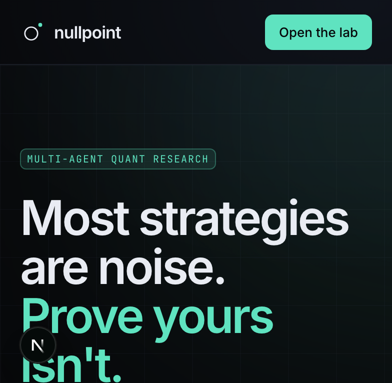

# Nullpoint

**Nothing ships until it beats the null.**

Nullpoint is a multi-agent autonomous quant research platform. Ten specialised agents propose,
implement, backtest and then try to falsify systematic strategies on free data. A strategy reaches the
leaderboard only after it survives an explicit anti-overfitting gauntlet, and nothing can place a live
order — that code path does not exist.

Research software only. Not investment advice, not a signal service, not a broker.



## What it does

- **10 agents, one typed bus.** Orchestrator, ideator, quant, engineer, backtester, skeptic, risk
  officer, librarian, portfolio manager, auditor. Every message, tool call and token is persisted and
  replayable.
- **Falsification, not curve fitting.** Walk-forward (anchored/rolling), purged + embargoed K-fold,
  CPCV, PBO/CSCV, deflated Sharpe against a global trial counter, Monte Carlo trade/block bootstrap,
  random-entry and signal-shuffle nulls, cost 2×/3× stress, execution delay, regime coverage and a
  sealed holdout.
- **Cost-aware engine.** Native NumPy/pandas reference implementation with next-bar fills, commission,
  spread, slippage, borrow, stops, position caps and vol targeting. `vectorbt` and `backtesting.py`
  adapters are optional extras.
- **Free data, honest labels.** Yahoo, Stooq, FRED, SEC EDGAR, Fama-French, Binance/ccxt, plus optional
  Alpha Vantage/Tiingo/Polygon/Alpaca keys. Every provider carries its licence note; every universe
  carries its survivorship-bias warning; synthetic fallback data is labelled at every layer.
- **Registry and portfolio.** Strategy versioning, lineage, diff, embedding dedupe, experiment ledger
  with data/code hashes, HRP / risk parity / inverse-vol / mean-variance construction, paper trading
  with drift, alerts, cost dashboard.
- **Product surface.** Next.js 15 app (dark-first brand, demo mode), FastAPI with JWT + API keys,
  Arq worker, Postgres, Parquet/DuckDB lake, Prometheus metrics, Docker Compose, CI.

## Quickstart

### Docker (full stack)

```bash
cp .env.example .env
docker compose up --build
# web  → http://localhost:3000
# api  → http://localhost:8000/docs
```

### Local

```bash
uv sync --extra dev
npm --prefix apps/web install
cp .env.example .env

make api      # http://localhost:8000/docs
make worker   # Arq worker (sprint queue + nightly drift)
make web      # http://localhost:3000
```

No Anthropic key? Set `LLM_PROVIDER=mock` (the default in tests). The mock provider runs the real
tools, backtests and validation gates deterministically.

### One command demo

```bash
python scripts/demo_sprint.py --synthetic
```

This creates a demo org (`demo@nullpoint.local` / `nullpoint-demo`), runs a complete sprint offline,
and prints the sprint id, trials, spend, strategies and tearsheet paths. Without `--synthetic` it tries
Yahoo/Stooq first and labels the dataset accordingly.

```bash
make seed           # demo org + ideas + sprint + portfolio
make tearsheet      # re-render standalone HTML tearsheets into artifacts/
make demo           # sprint on SPY/QQQ + sector ETFs
```

### Web without the API

The UI runs in **demo mode** when no token is present: deterministic, labelled demo data, all pages and
charts usable. Sign in at `/login` after starting the API to use real sprints.

## Repository layout

```
apps/api/          FastAPI app (routers, services, jobs, models, security)
apps/web/          Next.js 15 app (brand, pages, charts, API client, demo data)
engine/            backtest engine, features, metrics, portfolio, validation gauntlet
agents/            roster, orchestrator, bus, tools, templates, tearsheets, embeddings
data/              providers, quality checks, Parquet/DuckDB lake, universes, pipeline
sandbox/           AST scanner + Docker/subprocess runners for untrusted agent code
brand/             NAMES.md, BRAND.md, palette, logo/wordmark/favicon/OG SVGs
docs/              ARCHITECTURE, API, SECURITY, DATA_LICENSES, SETUP, DEMO, DECISIONS
infra/             Fly.io / Railway deployment configs and checklist
scripts/           demo sprint, seed, tearsheet re-render
tests/             engine, validation, noise gate, data, agents, API
```

## Validation gates

Configured in `engine/validation.py` (`GATES`) and applied to every candidate:

| Gate | Threshold |
|---|---|
| Deflated Sharpe (vs global trials) | ≥ 0.90 |
| PBO / CSCV | ≤ 0.35 |
| Walk-forward OOS Sharpe | ≥ 0.50 |
| WFO efficiency (OOS/IS) | ≥ 0.50 |
| Sharpe at 3× costs | ≥ 0.30 |
| Sharpe with 1-bar delay | ≥ 0.30 |
| Monte Carlo p-value | < 0.05 |
| Regime coverage | ≥ 3 regimes |
| Minimum track record | ≥ 8 years and ≥ 100 trades |
| Sealed holdout | untouched until final review |

One failed gate blocks promotion. Rejections are stored with a tearsheet; deleting them would make the
trial count lie.

## Status ladder and safety

`idea → backtested → validated → candidate → paper → live_ready`

`live_ready` is a **label for human review**, not an execution state. There is no broker order code
anywhere in the repository. Paper trading requires a stored human approval record; the simulator
bootstraps the strategy's own out-of-sample returns and is labelled simulated. Agent code executes in
a sandbox (no network, read-only mounts, CPU/RAM/PID/wall-clock limits, AST blocklist), never in the
API process.

## Quality gates

```bash
make check     # ruff + mypy + pytest with coverage
make cov       # engine/validation coverage must stay ≥ 80% (currently ~87%)
python -m pytest tests/test_noise_gate.py -q   # noise must never be promoted
```

CI runs lint, typecheck, full tests, the engine coverage gate, the noise gate and a production web
build.

## Configuration

See `.env.example`. Important variables:

| Variable | Default | Purpose |
|---|---|---|
| `DATABASE_URL` | sqlite in dev | Postgres in production (`postgresql+psycopg://…`) |
| `LLM_PROVIDER` | `mock` | `mock` or `anthropic` |
| `MODEL_ORCHESTRATOR/WORKER/SKEPTIC/CHEAP` | Claude models | model slots per role |
| `JOB_RUNNER` | `auto` | `arq`, `subprocess` or `sync` (tests only) |
| `ALLOW_NETWORK` | `true` | false forces the labelled synthetic path |
| `LAKE_ROOT` | `./artifacts/lake` | Parquet lake |
| `SANDBOX_BACKEND` | `auto` | `docker` or `local` |
| `KILL_SWITCH` | `false` | stop new sprints immediately |
| `ANTHROPIC_API_KEY` | — | required only for `LLM_PROVIDER=anthropic` |

Secrets belong in the environment or your platform's secret store, never in the UI or repository.

## Deploy

`infra/DEPLOY.md` covers Fly.io (API + worker + web), Railway and managed Postgres/Redis. The API and
worker share one image; the web image uses Next.js standalone output. `docker-compose.yml` is the
reference topology. Deployment is intentionally manual: this repository does not deploy itself.

## Documentation

- [Architecture](docs/ARCHITECTURE.md)
- [API](docs/API.md)
- [Security](docs/SECURITY.md)
- [Data licences and bias](docs/DATA_LICENSES.md)
- [Setup](docs/SETUP.md)
- [Demo](docs/DEMO.md)
- [Decisions](docs/DECISIONS.md)

## Limitations

- Free data is not point-in-time for most providers. Survivorship bias is flagged, not solved.
- The native engine is the tested reference; optional engines require their extras and are not covered
  by the engine coverage gate.
- LLM cost figures are estimates from published token prices, not invoices.
- Paper trading is simulation-first. Alpaca integration is read-only and restricted to paper endpoints.
- Multi-tenant isolation, auth and rate limits are implemented, but this is not a hardened
  internet-facing trading system; review `docs/SECURITY.md` before exposing it publicly.

---

Nullpoint · research only · not investment advice · backtests are hypotheses, not forecasts.
