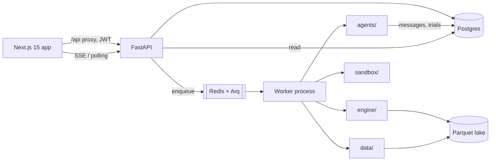

# Architecture

## Trust boundaries

1. **Browser** is untrusted. It holds a JWT (or API key) and never receives provider secrets.
2. **API process** handles auth, CRUD, serialization and SSE. It never executes agent-generated code.
   `JOB_RUNNER=sync` exists for tests only; production uses Arq or a detached subprocess.
3. **Worker** runs agents and the engine. Long jobs are bounded by budget, wall clock, iteration caps
   and a kill switch.
4. **Sandbox** executes strategy code with no network, read-only mounts, resource limits and an AST
   blocklist. Local runner is a development fallback, not a production boundary.
5. **Data lake** is a local Parquet store queried read-only through DuckDB (SELECT-only surface).

## Request flow: a sprint

1. `POST /sprints` validates the objective/universe and creates a `Sprint` row (`queued`).
2. The API enqueues the job and returns immediately (or runs synchronously in tests).
3. The orchestrator plans, asks the ideator for hypotheses, and hands each to the quant.
4. The quant writes `signal(features, params, close)`; the sandbox scans and executes it.
5. The backtester runs a parameter grid; every configuration increments the org-wide `TrialCounter`.
6. The skeptic runs the validation gauntlet. The sealed holdout is hashed before the sprint and is not
   readable by agents.
7. Surviving strategies become `candidate`; failures become `rejected` and still receive a tearsheet.
8. The auditor writes messages to `agent_message`; the UI replays them via `/messages` or SSE.

## Data model (core)

`organization → user/api_key → sprint → agent_message`
`idea → strategy → experiment → validation_report`
`strategy → approval → paper_run`
`trial_counter` is org-scoped and monotonic; `portfolio` stores weights + metrics.

All tenant tables carry `org_id`; every query in the routers filters by the authenticated principal's
org. IDs are opaque strings generated server-side.

## Engine

- `engine/strategy.py` — `StrategySpec` (universe, signal code, features, params, costs, risk).
- `engine/native.py` — reference backtester: signals at `t-1`, fills at next bar, costs, stops,
  rebalance schedules (daily/weekly/monthly), vol targeting, trade ledger.
- `engine/base.py` — `MarketData`, `EngineAdapter`, grid/WFO orchestration, adapter registry.
- `engine/validation.py` — CPCV/PBO, DSR, PSR, Monte Carlo, regime and cost stress, gate assembly.
- `engine/portfolio.py` — HRP, risk parity, inverse vol, mean variance, Kelly sizing.

Optional `vectorbt` and `backtesting.py` adapters raise `EngineUnavailable` with an install hint when
the extra is missing; the native engine is always available.

## Frontend

Next.js App Router. `/api/*` is rewritten server-side to the API origin, so the browser only talks to
its own origin (no CORS, no exposed internal host). Pages are client components using a small
`useApi` hook. With no token, the hook returns deterministic demo data and every screen labels it
"demo data". Charts use Recharts and the brand palette; metrics use JetBrains Mono.

## Failure modes

- Data provider unavailable → fallback provider, then clearly labelled synthetic data.
- Engine exception inside a strategy → strategy rejected, sprint continues.
- Budget/wall clock exhausted → sprint stops with `budget_exhausted` and partial results preserved.
- Redis unavailable → API can fall back to a detached subprocess (`JOB_RUNNER=subprocess`).
- API restart mid-sprint → messages and trials are already persisted; the UI resumes with `?after=`.
